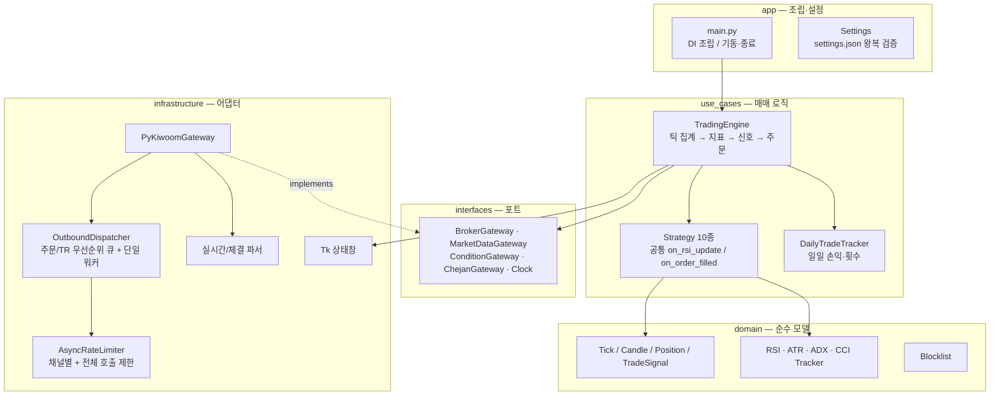

# Kiwoom RSI Auto Trader — Case Study

> 키움증권 OpenAPI+ 기반 **실시간 틱 집계 · 멀티 전략 자동매매 엔진**의 설계 기록입니다.
> 실계좌 운용 코드라 소스는 비공개이며, 이 레포에는 아키텍처·설계 결정·문제 해결 과정을 정리했습니다.
> 코드 리뷰가 필요하시면 요청 시 화면 공유로 보여드릴 수 있습니다.

## 한눈에 보기

| 항목 | 내용 |
| --- | --- |
| 역할 | 1인 설계·개발·운영 |
| 규모 | Python 약 2만 줄, 테스트 280+개 |
| 데이터 | 조건검색 편입 종목의 실시간 체결 틱 → N틱봉 / N분봉 집계 |
| 전략 | RSI, Adaptive, ADX/DMI, Failure Swing, Donchian Breakout, Supertrend, Flow Momentum, Livermore Pyramid 계열 등 **10종**을 공통 인터페이스로 교체 가능 |
| 리스크 관리 | ATR 기반 진입·추가매수·trailing stop, 재매수 cooldown, 종목 blocklist, 모의/실전 서버 불일치 시 주문 차단 |
| 운영 도구 | Tkinter 실시간 상태창, 일일 거래 통계, OHLC 백테스트 스크립트 |

## 아키텍처

Clean Architecture 방식으로 **도메인·유스케이스를 증권사 API에서 분리**했습니다.
키움 API는 `interfaces`의 Protocol(포트) 뒤에 숨겨져 있어, 전략과 엔진은 fake gateway로 단위 테스트됩니다.

## 설계 결정과 해결한 문제

### 1. 틱 폭주 대응 — 샤드 큐와 backpressure
장 초반이나 급등 종목에서는 실시간 틱이 순간적으로 몰려 지표 계산이 밀립니다.
- 틱 계산을 **N개 샤드 큐 + 워커**로 분산하고, 샤드별 최대 적재량·드롭 수를 기록해 병목 샤드를 바로 찾을 수 있게 했습니다.
- 큐가 한계에 가까워지면 오래된 틱을 일괄 폐기하는 **emergency drop**과 backpressure 로그로, 지연된 데이터로 주문이 나가는 것을 막았습니다.
- 단일 큐로 되돌리는 호환 모드를 남겨 두고, 부하 테스트 스크립트(`tick_queue_load_test`)로 두 방식을 비교했습니다.

### 2. 키움 API 동시 접근과 호출 제한
키움 OpenAPI+는 COM 객체라 여러 스레드에서 동시에 호출하면 불안정하고, TR·주문 호출 횟수 제한도 있습니다.
- 주문 큐와 TR 큐를 **분리된 PriorityQueue**로 두되, 실제 API 호출은 **단일 워커 스레드로 직렬화**했습니다.
- 채널별(TR/주문)과 전체 호출 수를 각각 제한하는 **슬라이딩 윈도우 rate limiter**를 두고, clock과 sleep을 주입해 테스트할 수 있게 했습니다.

### 3. 봉 마감 전 반응 속도
N틱봉이 닫힐 때만 RSI를 계산하면 급변 구간에서 진입이 늦었습니다.
진행 중인 봉으로 **preview RSI**를 계산하고, 봉 내부 보조 트리거(`intracandle subtrigger`)를 추가해 확정 신호와 분리해서 다루도록 했습니다.

### 4. 분봉 백필
장중에 편입된 종목은 과거 데이터가 없어 지표가 바로 안정되지 않습니다.
최근 틱 버퍼로 1분봉과 소형 틱봉을 동시에 재구성해, 편입 직후에도 RSI·ATR이 정상 범위에서 시작하도록 했습니다.

### 5. 전략 디버깅 — 신호 중복과 필터 충돌
Adaptive 전략에서 신호 중복 발생, RSI 임계값 사이의 공백, ATR trailing stop 활성화 시점, ADX 필터의 신호 억제 같은 로직 문제를 찾아냈습니다.
재현 스크립트와 회귀 테스트를 먼저 만든 뒤 수정하는 순서로 진행했습니다.

## 테스트

- 전략별 단위 테스트(신호 생성, 분할 매수·매도, retry 소진 처리)
- 설정 왕복(load → save → load) 테스트
- 엔진의 캔들 설정·Livermore 재주문 시나리오 테스트
- 브로커는 Protocol 기반 fake로 대체해 **실계좌 없이 전체 흐름을 검증**합니다.

## 관련 프로젝트

- [KORStockScan](../../README.md) — 이 엔진의 경험을 바탕으로 만든 키움 REST/WebSocket 기반 차세대 스캘핑 시스템 (AI 판단 계층, 장후 자동 튜닝)

---

이 문서는 투자 권유가 아니며, 공개된 내용에는 계좌 정보·API 키·실전 파라미터가 포함되어 있지 않습니다.
