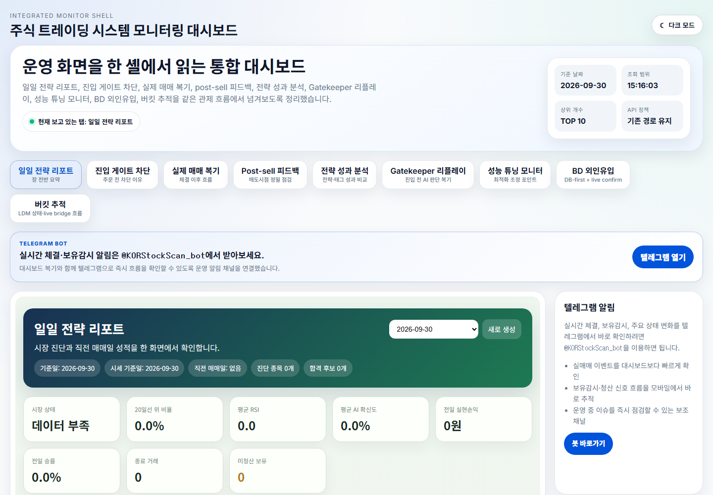

# KORStockScan 웹 대시보드

KORStockScan의 웹 화면은 일일 전략 결과와 진입·체결·매도 이후 흐름을 한곳에서 살펴보는 운영 대시보드입니다. 기본 주소는 `http://127.0.0.1:5000/dashboard`입니다.

## 화면 캡처



2026-09-30에 실행 중인 로컬 웹 서비스의 `/dashboard?tab=daily-report`를 캡처했습니다. 당시 새 PostgreSQL 환경에는 당일 보고서 데이터가 없어 리포트의 일부 지표가 `데이터 부족`으로 표시됩니다. 화면의 숫자는 매매 성과 예시가 아닙니다.

## 주요 기능

| 화면 | 확인할 수 있는 내용 |
| --- | --- |
| **일일 전략 리포트** | 선택 날짜의 전략 요약, 시장 상태, 거래·성과 지표 |
| **진입 게이트 차단** | 후보가 주문 전 어느 단계에서 차단됐는지와 차단 사유 |
| **실제 매매 복기** | 실제 거래의 체결 이후 흐름과 매매 결과 |
| **Post-sell 피드백** | 매도 시점과 매도 이후 움직임을 비교하는 피드백 |
| **전략 성과 분석** | 전략·태그별 거래 성과 비교 |
| **Gatekeeper 리플레이** | 진입 전 AI 판단과 게이트 결과 복기 |
| **성능 튜닝 모니터** | 진입·보유·청산 관련 최적화 관찰 지표 |
| **BD 외인유입** | DB 우선 외인유입 후보와 실시간 확인 결과 |
| **버킷 추적** | Lifecycle Decision Matrix 버킷 상태와 live bridge 흐름 |

상단 탭에서 화면을 전환하고, 각 화면에서 제공하는 날짜·조회 시작 시각·표시 개수 조건을 사용할 수 있습니다. 밝은 화면과 어두운 화면을 전환하는 버튼 및 텔레그램 알림 채널 링크도 제공됩니다. 보고서가 없는 날짜에는 해당 화면에 빈 상태나 데이터 부족 안내가 나타날 수 있습니다.

## 실행

`.env`와 `data/config_prod.json`을 준비한 뒤 다음 명령으로 DB, 스키마 초기화, 웹 서비스를 실행합니다.

```bash
docker compose up -d --build db schema web
```

컨테이너 구성과 실주문 봇의 별도 실행 경계는 [Docker Compose 안내](deploy/docker/README.md)를 참고하세요.
